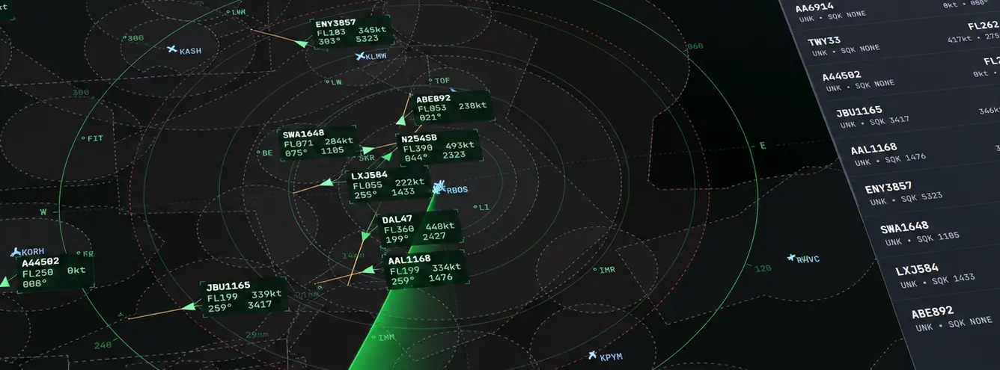

# ADSB Radarscope v2

ADSB Radarscope displays live ADS-B aircraft data in a web browser. Connect it
to a dump1090, readsb, tar1090, PiAware, or compatible `aircraft.json` feed.

- Track aircraft with position labels, trails, and prediction vectors.
- Select aircraft, search traffic, and sort the aircraft table.
- Show airports, runways, navigation aids, and controlled airspace.
- Show separation conflicts and emergency squawk alerts.
- Select the Phosphor or Console layout and a radar color theme.

**Version:** v2.5.0 beta 67 · **License:** [GPL](LICENSE)

**Version 1 is archived and no longer supported.** Use v2 for new installations.
The [v1 archive](https://github.com/dustsignal/adsb-radarscope/tree/archive/v1) and
[original v1.0.16 release](https://github.com/dustsignal/adsb-radarscope/releases/tag/v1)
remain available for historical reference.

## Features

### Aircraft tracking

The radar shows aircraft positions, callsigns, altitude, speed, trails, and
prediction vectors when the receiver supplies the required data. Select an
aircraft to inspect its details. Use the aircraft table to sort traffic or the
search palette to find an aircraft or airport.

### Alerts

Separation conflict indicators identify aircraft that meet the configured
conflict criteria. Emergency squawk indications identify codes **7500**, **7600**,
and **7700**. Enable sound in Settings to hear alerts.

### Aviation overlays

Show airports, runway layouts, navigation aids, and controlled airspace. Enable
only the layers you need. Reference data is processed locally in the browser.

### Display layouts

| Layout | Description |
| --- | --- |
| Phosphor | Green radar display with CRT styling and floating information panels. |
| Console | Dual-pane display with a persistent aircraft list and inspection panel. |

Radar color themes are independent of the layout: Phosphor, Console, Amber CRT,
Arctic Blue, Cyberpunk, and Parchment.

## Requirements

For a source build, install:

- Python 3.9 or later, with `pip` and `venv` available.
- Node.js 18 or later, with npm available on `PATH`.
- A web browser with Canvas, Web Workers, WebAssembly, and local storage support.

Internet access is necessary to download dependencies and reference data.
A receiver connection is necessary for live traffic. A compiled release needs
Python and a browser for local operation; it does not need Node.js.

## Build and start

1. Extract the complete source package.
2. Open a terminal in the folder that contains `build.py` and `package.json`.
3. Start the build procedure:

   ```sh
   python build.py --serve
   ```

   On Windows, use `py -3` if `python` is not available. On macOS or Linux, use
   `python3` if necessary.

4. Follow the prompts. Keep the default output folder, `dist/`. Select data
   updates and dependency installation. Set the home latitude, longitude, receiver
   URL, range, polling interval, layout, colors, and sound. WebSocket setup is optional.
5. Review the execution plan. Confirm the plan to start the build.
6. Wait for **RELEASE BUILD READY**. The default output folder is `dist/`.
7. Open `http://localhost:8080` if the browser does not open automatically.
8. Confirm that the feed connects and aircraft with valid positions appear.
   Check that the home position and range cover the receiver area.

The builder performs these operations:

1. Checks the project and build tools.
2. Downloads missing or invalid airport, runway, and navigation aid CSV files.
   Reuses valid files unless an update is selected.
3. Generates missing airspace data, or updates it when selected. Installs the
   required airspace tools in `.build-venv/` and exports individual airspace tiles.
4. Installs npm dependencies from the lock file and checks production dependencies
   for vulnerabilities of high severity or greater.
5. Builds the application, copies `serve.py`, and writes `runtime-config.json`
   with the selected first-run settings.

To build without starting a server, use `python build.py`. To stop a running
server, press `Ctrl+C`.

### Build without prompts

Replace the example feed address and coordinates with your station values:

```sh
python build.py --yes --feed-url http://192.168.1.100/tar1090/data/aircraft.json --home-latitude 40.0 --home-longitude -75.0 --range-nm 75 --poll-interval 1000 --ui-theme console --serve
```

For PiAware, the feed can be
`http://192.168.1.100:8080/data/aircraft.json`. Receiver paths and ports can differ.
Use an absolute receiver URL with the local server. The default relative path,
`/tar1090/data/aircraft.json`, requires a feed at that path on the application server.

### Build options

| Option | Function |
| --- | --- |
| `--help` | List all options. |
| `--check` | Check npm availability and reference data without changing files. This does not compile the application. |
| `--yes --dry-run` | Show the build plan without executing it. |
| `--refresh-data` | Download current airport, runway, and navigation aid CSV files. |
| `--refresh-airspace` | Download FAA airspace data and generate new tiles. |
| `--skip-airspace` | Skip airspace generation and its data requirement. |
| `--data-only` | Prepare reference data without compiling the application. |
| `--skip-install` | Reuse installed npm dependencies. |
| `--npm PATH` | Select an npm executable explicitly. |
| `--serve` | Start the local server after the build. |
| `--serve-only --output dist` | Serve an existing `dist/` release without rebuilding. Specify the output folder explicitly. |
| `--port 8081` | Change the local server port. |
| `--no-open` | Start the server without opening a browser. |

Additional first-run options are `--scope-theme`, `--enable-sound`, `--ws-url`,
and `--enable-websocket`. Use `--enable-websocket` with `--ws-url`. The bridge
must already exist and emit compatible JSON messages; the browser does not decode
raw Beast binary data, and the builder does not install a bridge.

## Install a compiled release

1. Copy or extract the complete release folder to the destination computer.
2. Keep `index.html`, `assets/`, `data/`, `runtime-config.json`, `serve.py`, and
   the supplied WebAssembly files together.
3. Open a terminal in the release folder and run:

   ```sh
   python serve.py
   ```

4. Open `http://localhost:8080` if necessary. Keep the terminal open during use.
5. Press `Ctrl+C` to stop the server.

To change the port, use `python serve.py --port 8081`. The server accepts
connections from the local computer only. It includes a feed relay for receivers
that do not supply browser CORS headers.

If the launcher reports that a compiled release is missing, check the release
contents. From the source folder, you can serve the build explicitly:

```sh
python build.py --serve-only --output dist
```

### Install on a web server

Copy the complete release contents to a static web server. Serve JavaScript as
JavaScript and `.wasm` files as `application/wasm`. Relative asset paths permit
installation in a server subdirectory.

A static server does not provide the Python feed relay. Configure a same-origin
feed proxy or permit the application origin in the receiver's CORS response
headers. Use an HTTPS feed when the application uses HTTPS. A shared local
network does not remove browser CORS requirements.

## Configure and operate

Open **Settings → System** to change the home position, feed URL, and polling
interval. Select **Apply & Save Settings**. Saved browser settings take priority
over `runtime-config.json`. A rebuild does not replace an existing user's settings.

For a different default configuration, run the builder again or edit the settings
in the release's `runtime-config.json`. Reload the application after an edit.

- Click an aircraft to show its details.
- Drag the scope to move the center. Use the mouse wheel to change range.
- Press `Ctrl+K` or `Cmd+K` to search for aircraft or airports.
- Use Settings to change overlays, trails, vectors, colors, and sounds.
- Interact with the page to permit browser audio playback.

Reference data operates locally after installation. To update it and rebuild, run:

```sh
python build.py --refresh-data --refresh-airspace
```

Deploy the new output folder after the build completes.

## Screenshots

### Full-viewport radar

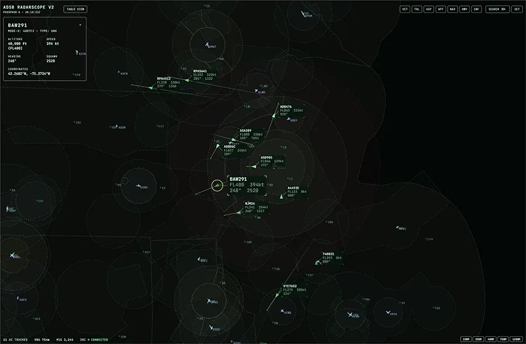

### Phosphor and Console layouts

**Phosphor**

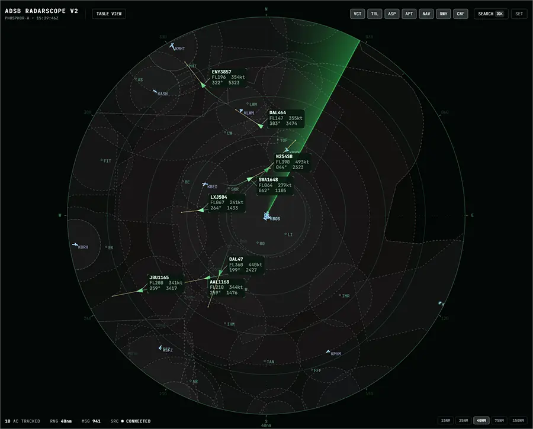

**Console**

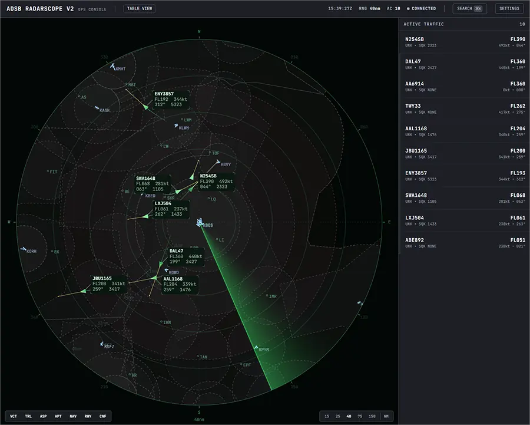

### Aircraft data table

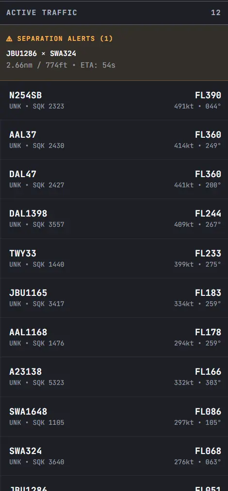

### Separation alerts

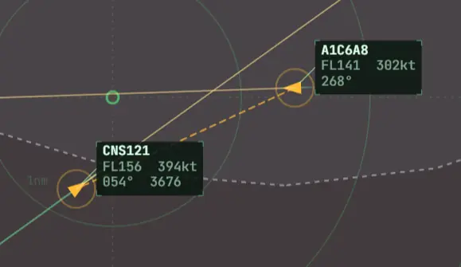

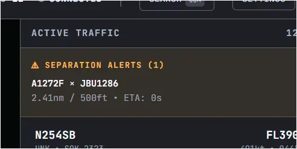

### Settings

**Display**

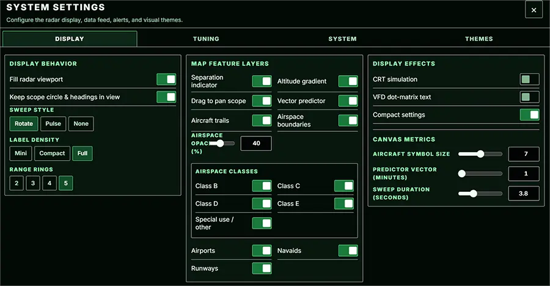

**Tuning**

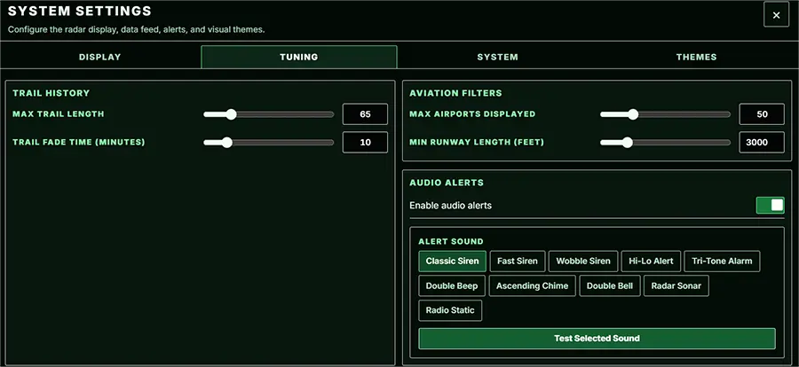

**System**

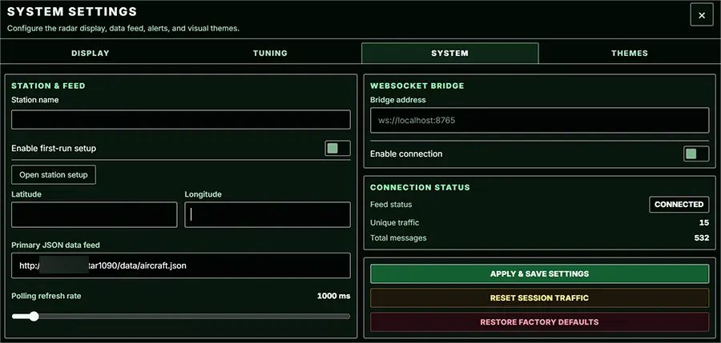

**Themes**

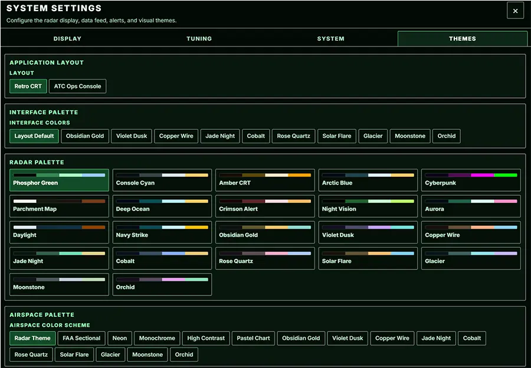

## Reference data

| Data | Provider or format | Use |
| --- | --- | --- |
| Airports | OurAirports CSV | Airport positions and labels. |
| Runways | OurAirports CSV | Runway geometry. |
| Navigation aids | OurAirports CSV | Navigation aid positions and symbols. |
| Controlled airspace | FAA data, MBTiles, and exported tiles | Airspace boundaries for the visible area. |

The builder downloads or generates these files in `public/data/` and includes
them in the compiled release. Keep the complete `data/` directory when you copy
a release. Do not substitute the archived v1 data files.

After installation, these overlays do not require a separate online map service.
Live traffic still requires the receiver feed. Coverage depends on the reference
data supplied with the release.

## Troubleshooting

| Problem | Action |
| --- | --- |
| Python or npm not found | Install the required tool. Open a new terminal. Use `--npm PATH` for an explicit npm location. |
| Airspace generation fails | Check internet access and Python `pip` and `venv` support. Use `--skip-airspace` if airspace is not required. |
| Dependency audit stops the build | Read the reported package and vulnerability. Correct the dependency issue before rebuilding. |
| No aircraft | Open the receiver URL directly. Check receiver operation, home coordinates, range, and saved settings. |
| Feed request blocked | Use the supplied local server. For web hosting, check the proxy, CORS, and HTTP/HTTPS settings. |
| Map data missing | Run `python build.py --check`. Restore or regenerate the data, rebuild, and deploy the complete output folder. |
| Port occupied | Start the server with `--port 8081`, then open the displayed address. |
| Old settings remain | Change the values in System settings and save them. Browser settings override release defaults. |

## License

See [LICENSE](LICENSE) for the GNU General Public License terms. Reference data
retains the terms of its provider, including OurAirports and FAA source data.
